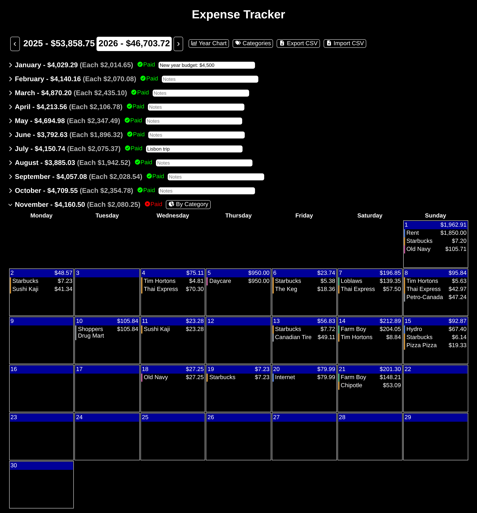
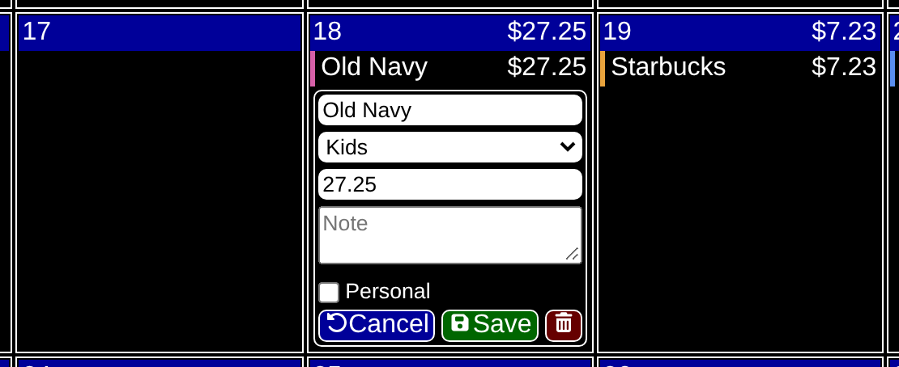
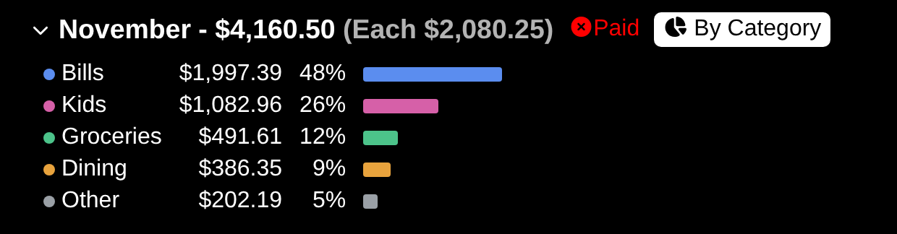
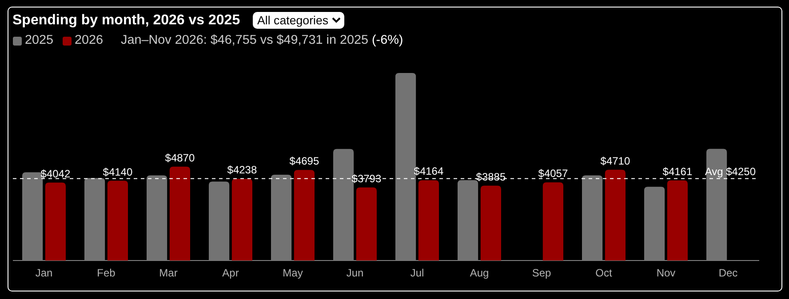
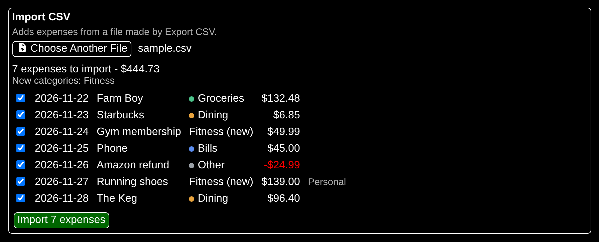

# Expense Tracker

A web app for tracking household expenses, built with Spring Boot and React (TypeScript). Expenses are shown on a calendar by year and month, with each month's total and each person's half of it. Changes sync live across open browser tabs over WebSocket.



## Features

- **Calendar view** by year and month, with daily, monthly and yearly totals, a "Paid" toggle and a note for each month.
- **Add and edit expenses** inline: name, category, amount, note, and a "Personal" flag that leaves it out of the split.

  

- **By Category** breakdown for any month.

  

- **Year Chart** comparing each month with the previous year, overall or for one category.

  

- **Categories** with colors: add, rename, recolor and merge.
- **CSV export and import**, with a preview that flags duplicates, unreadable rows and new categories.

  

## Running it

### Docker (recommended)

A single container with an embedded H2 database, stored in the `expenses` volume:

```
docker compose up -d --build
```

Open http://localhost:8080. See [DOCKER.md](DOCKER.md) for backups and everyday commands.

### Locally

Needs Java 17. Maven downloads Node and builds the React bundle with webpack.

With PostgreSQL on `localhost:5432` (user and password `postgres`, set in `application.yml`):

```
./mvnw spring-boot:run
```

Without PostgreSQL, use the embedded database (saved under `./data`):

```
./mvnw spring-boot:run -Dspring-boot.run.profiles=embedded
```

Add the `dev` profile (e.g. `dev,embedded`) to start from sample data. It recreates the tables on every start, so don't use it with real data.

While working on the frontend, `npm run watch` rebuilds the bundle on save.

> The app has no login and exposes all actuator endpoints, so keep it on localhost or behind authentication.
